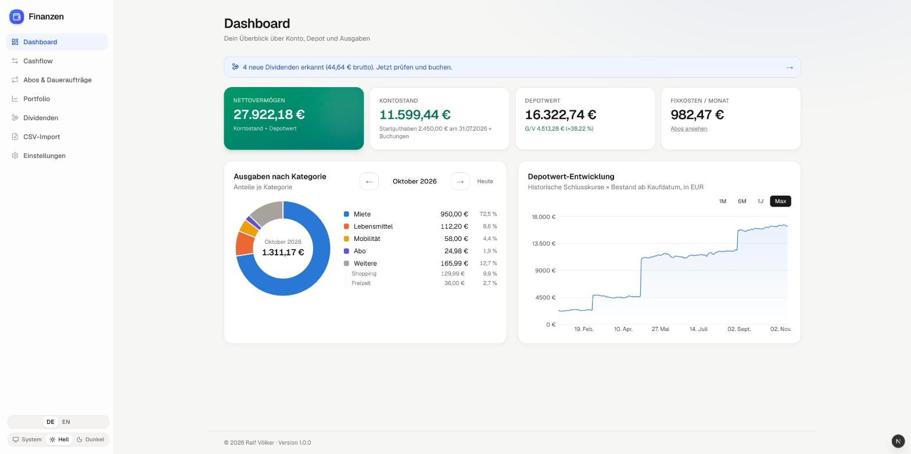
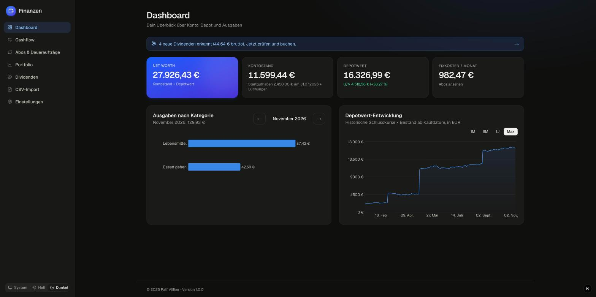
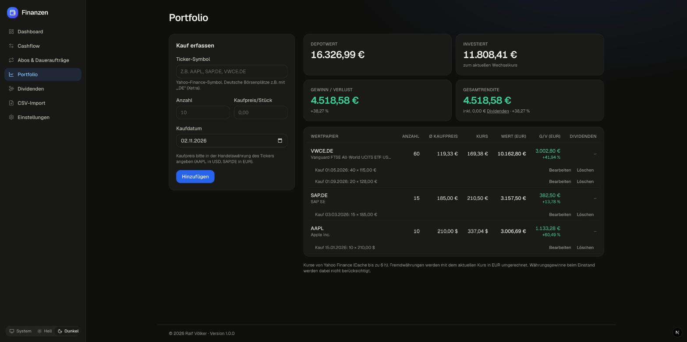

# Finanzen – Personal Finance & Portfolio

Lokale Web-App für den Überblick über die eigenen Finanzen: Einnahmen und Ausgaben, Abos und Daueraufträge, Wertpapierdepot mit aktuellen Kursen, Dividenden und Nettovermögen, alles in Euro. Die Daten liegen in einer SQLite-Datei auf deinem Rechner.


<p>
  
  
</p>

## Funktionen

**Cashflow**
- Einnahmen und Ausgaben mit Kategorie, Datum, Notiz und Gegenpartei erfassen, bearbeiten und löschen
- Monatsansicht mit Summen für Einnahmen, Ausgaben und Saldo

**Abos & Daueraufträge**
- Wiederkehrende Buchungen: wöchentlich, monatlich, vierteljährlich oder jährlich
- Fällige Termine werden automatisch gebucht, auch rückwirkend und ohne Dubletten
- Pausieren, Fortsetzen, Bearbeiten, Übersicht der monatlichen Fixkosten

**Portfolio**
- Käufe mit Ticker, Anzahl, Kaufpreis und Kaufdatum erfassen; das Symbol wird bei Yahoo Finance geprüft
- Aktuelle Kurse, Wert, Gewinn/Verlust und Gesamtrendite, umgerechnet in EUR (auch USD, GBp usw.)
- Depotverlauf aus historischen Schlusskursen

**Dividenden**
- Erkennt Ausschüttungen deiner Wertpapiere und schlägt sie vor: brutto und geschätztes Netto
- Buchen mit dem tatsächlich erhaltenen Betrag oder mit einer importierten Gutschrift verknüpfen
- Summen je Jahr und je Wertpapier

**CSV-Import für Kontoauszüge**
- Erkennt die Formate von Sparkasse, ING, DKB, comdirect, Volksbank/Raiffeisenbank und N26; andere Banken lassen sich manuell zuordnen
- Vorschau vor dem Import mit Kategorie-Vorschlägen, die aus früheren Buchungen lernen
- Erkennt bereits importierte Zeilen und mögliche Dubletten; jeder Import lässt sich rückgängig machen

**Dashboard**
- Nettovermögen (Kontostand + Depotwert), Kontostand mit Startguthaben, Fixkosten
- Ausgaben nach Kategorie und Depotwert-Entwicklung als Diagramm

**Oberfläche**
- Deutsch und Englisch, umschaltbar in der Seitenleiste; Zahlen und Datumsangaben im passenden Format
- Heller und dunkler Modus (folgt auf Wunsch dem Betriebssystem)
- Große, gut lesbare Schrift; funktioniert auch auf schmalen Bildschirmen



## Schnellstart

Voraussetzung: [Node.js](https://nodejs.org) **22.12 oder neuer**.

```bash
git clone git@github.com:howard-web/finanz_app.git
cd finanz_app

npm install                    # installiert Abhängigkeiten und erzeugt den Prisma Client
cp .env.example .env           # Konfiguration (Pfad zur Datenbank)
npx prisma migrate deploy      # legt die Datenbank prisma/dev.db an
npm run db:seed                # optional: Beispieldaten laden

npm run dev
```

Danach läuft die App unter **http://localhost:3000**. Du wirst automatisch auf `/de` oder `/en` weitergeleitet, je nach zuletzt gewählter Sprache bzw. Browser-Sprache.

> **Achtung:** `npm run db:seed` löscht alle vorhandenen Daten und ersetzt sie durch Beispieldaten. Nur für einen ersten Eindruck verwenden.

### Erste Schritte mit eigenen Daten

1. **Einstellungen → Startguthaben:** aktuellen Kontostand mit Datum eintragen, damit das Nettovermögen stimmt.
2. **Portfolio:** Wertpapiere mit Kaufdatum erfassen, z. B. `AAPL`, `SAP.DE` oder `VWCE.DE`. Den Kaufpreis gibst du in der Handelswährung des Tickers an.
3. **Cashflow:** Buchungen erfassen oder Kontoauszüge per **CSV-Import** einlesen. Wiederkehrende Posten mit dem Haken „Wiederkehrend“ anlegen.
4. **Dividenden:** Erkannte Ausschüttungen prüfen und buchen.

## Skripte

| Befehl | Zweck |
| --- | --- |
| `npm run dev` | Entwicklungsserver auf Port 3000 |
| `npm run build` / `npm start` | Produktions-Build erstellen und starten |
| `npm run lint` | ESLint |
| `npm run db:migrate` | Neue Migration nach Schema-Änderung erstellen (`prisma migrate dev`) |
| `npm run db:seed` | Beispieldaten laden (**löscht vorhandene Daten**) |
| `npm run db:studio` | Datenbank im Browser ansehen (Prisma Studio) |

## Daten & Datenschutz

- **Alles bleibt lokal:** Alle Daten liegen in `prisma/dev.db` auf deinem Rechner. Datenbank und `.env` sind von Git ausgeschlossen. Für ein Backup kopierst du einfach `prisma/dev.db`.
- **Yahoo Finance:** Die App fragt dort nur Ticker-Symbole ab (Kurse, Kursverlauf, Dividenden, Wechselkurse), keine persönlichen Daten.
- **CSV-Import:** Die Datei wird im Browser gelesen. An den lokalen Server gehen nur Datum, Betrag, Gegenpartei und Verwendungszweck, keine IBANs oder Kontodaten.
- **Keine Anmeldung:** Die App hat keine Benutzerverwaltung und ist für die Nutzung auf dem eigenen Rechner gedacht. Betreibe sie nicht öffentlich im Internet.

## Tech-Stack

- [Next.js 16](https://nextjs.org) (App Router, Server Actions, Cache Components) mit React 19 und TypeScript
- [Tailwind CSS 4](https://tailwindcss.com) mit eigenen Farb-Tokens für Hell/Dunkel, Icons von [Lucide](https://lucide.dev)
- [Prisma 7](https://www.prisma.io) mit SQLite über `better-sqlite3`
- [yahoo-finance2](https://github.com/gadicc/yahoo-finance2) für Kurse, Wechselkurse und Dividenden
- [Recharts](https://recharts.org) für Diagramme, [Zod](https://zod.dev) für die Validierung

## Projektstruktur

```
prisma/
  schema.prisma        Datenmodell
  migrations/          Datenbank-Migrationen
  seed.ts              Beispieldaten
src/
  app/[lang]/          Seiten (je Sprache): Dashboard, Cashflow, Abos, Portfolio, Dividenden, Import, Einstellungen
  i18n/                Sprachen: Wörterbücher (de.ts, en.ts), Zugriff für Server und Browser
  proxy.ts             Weiterleitung von Adressen ohne Sprachpräfix
  actions/             Server Actions (Speichern, Löschen, Import …)
  components/          UI-Komponenten, Formulare, Diagramme
  lib/                 Fachlogik: Kontostand, Portfolio, Dividenden, wiederkehrende Buchungen
  lib/market/          Yahoo Finance (Kurse mit Cache) und Wechselkurse
  lib/import/          CSV-Parser, Bank-Erkennung, Kategorie-Regeln
docs/screenshots/      Bilder für diese README
```

## Wie gerechnet wird

<details>
<summary>Details zu Beträgen, Kontostand, Kursen und Import</summary>

- **Sprachen:** Jede Seite gibt es unter `/de/…` und `/en/…`, beide werden vorgerendert. Kategorien werden unter ihrem deutschen Namen gespeichert und nur in der Anzeige übersetzt. Betragseingaben verstehen beide Schreibweisen (`1.234,56` und `1,234.56`). Neue Texte gehören in `src/i18n/dictionaries/de.ts`; die Typprüfung meldet, wenn sie in `en.ts` fehlen.
- **Beträge** werden als ganze Cent gespeichert, Datumswerte als UTC-Mitternacht. So gibt es weder Rundungsfehler noch Verschiebungen durch Zeitzonen oder Sommerzeit.
- **Kontostand** = Startguthaben (Kontostand am Ende eines Stichtags) + alle Buchungen *nach* dem Stichtag. Ohne Startguthaben ist es der Saldo aller Buchungen. Buchungen am oder vor dem Stichtag zählen weiterhin in den Monatsauswertungen.
- **Nettovermögen** = Kontostand + aktueller Depotwert.
- **Wiederkehrende Buchungen** werden beim Seitenaufruf bis einschließlich heute gebucht. Termine werden immer vom Startdatum aus berechnet: Ein Abo am 31. bucht in kürzeren Monaten am Monatsletzten und springt danach wieder auf den 31. Doppelte Buchungen verhindert ein eindeutiger Schlüssel (Regel + Datum). Beim Fortsetzen einer pausierten Regel werden verpasste Termine nicht nachgebucht.
- **Kurse** werden bis zu 6 Stunden zwischengespeichert. Ist Yahoo nicht erreichbar, zeigt die App den letzten bekannten Kurs und markiert ihn als veraltet.
- **Fremdwährungen** werden mit dem aktuellen Wechselkurs in EUR umgerechnet. Kurse in Pence (GBp) werden durch 100 geteilt.
- **Depotverlauf:** historische Schlusskurse × Bestand ab Kaufdatum.
- **Dividenden:** Grundlage sind Ex-Tag und Betrag pro Aktie von Yahoo, gerechnet wird mit dem Bestand vor dem Ex-Tag. Das Netto wird mit einem einstellbaren Steuersatz geschätzt (Standard 26,375 % = Abgeltungsteuer + Soli).
- **CSV-Import:**
  - Eine Zeile gilt als bereits importiert, wenn Datum, Betrag und Text übereinstimmen. Gleiche Zeilen in einer Datei werden durchnummeriert.
  - Als mögliches Duplikat gilt eine manuelle oder Abo-Buchung mit gleichem Betrag innerhalb von ±3 Tagen.

</details>

## Bekannte Einschränkungen

- **Keine Verkäufe:** Die App kennt nur Käufe. Der Bestand ist die Summe der erfassten Käufe.
- **Wechselkurs:** Einstand, Depotverlauf und Dividenden werden mit dem *aktuellen* Wechselkurs umgerechnet. Währungsgewinne oder -verluste seit dem Kauf sind nicht enthalten.
- **Dividenden:** Yahoo liefert den Ex-Tag, nicht den Zahltag. Das Datum der Gutschrift passt du beim Buchen an.
- **Yahoo Finance** hat keine offizielle API. Wenn Yahoo etwas ändert, können Kurse vorübergehend fehlen.
- **Nur Euro:** Euro ist die einzige Basiswährung.

## Copyright

© 2026 Ralf Völker. Alle Rechte vorbehalten.
